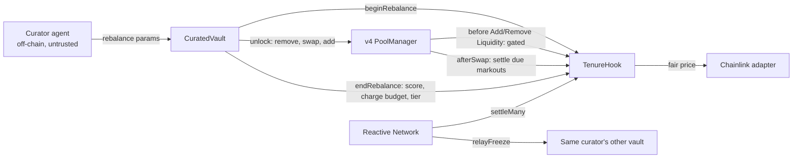

# Tenure: earned autonomy for AI liquidity curators

**We don't try to detect when an AI curator is compromised. We measure the damage its decisions cause, and its
autonomy shrinks automatically when it starts losing depositors' money.**

A Uniswap v4 hook (UHI11 hookathon, theme: Curated Liquidity). Every curator rebalance is scored at a fair
oracle price, and losses drain a risk budget. The curator drops from FULL to RESTRICTED to FROZEN as the budget
empties, and it can only earn more room (budget and deposit cap) with proven positive results.


| | Static caps only | With Tenure |
|---|---:|---:|
| Poisoned curator stopped | never (25 attack rounds) | **FROZEN on 20 / 20 seeds, 60-76 blocks after poisoning** |
| Attacker profit (median of 20 seeds) | 1,587 tokens | **650 tokens (-59%)** |
| Value kept for depositors vs static caps (median) | - | **2,771 tokens (3.5% of NAV) per run** |

The honest curator was never restricted (FULL in every block of every seed). Source: [`docs/RESULTS.md`](docs/RESULTS.md).

---

## The problem

- In curated liquidity, depositors hand money to a curator who manages LP positions, and the curator is fully
  trusted. Arrakis states that its manager is off-chain and trusted, bounded only by static per-block limits.
- Mandate drift is real. In the Stream Finance collapse (Nov 2025), a curator changed strategy without depositor
  consent, and risk-curator vault TVL fell from about $10B to about $6.9B within days.
- AI curators make it worse. Princeton's CrAIBench (arXiv 2503.16248) shows that memory or context injection makes
  agents take harmful actions, and that injection detectors help little once stored context is corrupted. You
  cannot reliably detect a poisoned agent by inspecting the agent.
- Static caps stop one big loss, but not a slow bleed of many small, individually valid bad decisions. The killer
  attack: poison the curator into placing liquidity at a manipulated price, then trade against it. No theft
  transaction ever happens.

## How it works: four layers

1. **Mandate.** Bounds the depositors agreed to: range width, maximum distance from the fair price, maximum value
   swapped per action, cooldown. Changes are timelocked, so depositors can exit first.
2. **Decision measurement (the core).** Every rebalance is scored at the fair price. Immediate leakage is charged
   at once. After W blocks, a markout `alpha` compares the decision with not rebalancing at all.
3. **Risk budget to autonomy tiers.** A leaky bucket that losses drain and slow refill restores. FULL is at least
   50% of the bucket, RESTRICTED is 20-50% (half the move cap, double cooldown and min width), and FROZEN is below
   20% (safe mode; only the guardian can restore, after a timelock, and only to RESTRICTED).
4. **Pool-native reputation.** The bucket size and the vault's deposit cap grow only with positive alpha that the
   hook itself measured. There is no external, Sybil-prone score.

Withdrawals are always open: no tier check, no oracle, no price.

## Comparison to existing approaches

| Approach | What it bounds | What it misses | Tenure |
|---|---|---|---|
| Bounded-leakage managers (Arrakis: an off-chain, trusted manager limited by static per-action / per-block limits) | The size of any single bad action | A slow bleed of many small, individually valid actions; the limits never tighten after losses | Scores every action at the fair price and accumulates the damage, so a 3-round bleed ends in FROZEN |
| Guardians and timelocks (Morpho and Yearn vault curators) | Configuration changes: depositors get time to exit before new parameters apply | The outcome of decisions made inside an unchanged configuration | Keeps a timelocked mandate, and also grades every decision made inside it |
| Curator scorecards and risk ratings | Nothing on-chain: they inform depositors after the fact | Enforcement; they rely on external, gameable data | Reputation is measured by the hook itself and enforced on-chain (budget, tier, deposit cap) |
| Agent policy hooks (Kusari, ETHGlobal Mumbai 2026: a hook enforcing per-agent policies set in ENSv2 on the agent's own swaps: per-swap and daily caps, allowed pool, max price impact, signed minimum output and intent) | What an agent may do | It does not measure decision quality or adjust autonomy | Measures the value lost by each move at the fair price, and shrinks autonomy as losses add up |

The difference in one line: other approaches limit what a curator may do. Tenure measures what its decisions
actually cost depositors, and grants or withdraws autonomy based on that.

## Theme mapping: Curated Liquidity, active management and curation

| Theme idea | In Tenure |
|---|---|
| Curator strategy parameters | The **mandate**: width bounds, maximum distance from fair, move cap, cooldown, timelocked changes |
| AI curator driven by off-chain signals or ML | The untrusted off-chain **curator agent**. Tenure grades its decisions, not its model or prompts |
| Reputation-weighted AUM | The **deposit cap** and the risk bucket grow only with alpha the hook measured itself |
| Active management with guardrails | **Autonomy tiers**: FULL, then RESTRICTED (tighter mandate), then FROZEN (safe mode, guardian restore) |

## Why it must be a hook

- The hook gates every `modifyLiquidity` on the vault's position. The curator cannot move liquidity outside a
  measured session (`Tenure__NoSession`).
- The hook reads pool state and the vault's position directly from the PoolManager, so it measures independently
  of the curator.
- Markouts settle keeper-free in `afterSwap` (at most one per swap), and anyone can settle them.



## Partner integrations

Only integrations that are built, tested and deployed are listed.

### Chainlink: the fair price

`ChainlinkReferencePrice` turns two token/USD feeds (or one direct feed) into the fair `sqrtPriceX96` that every
score uses. Stale, incomplete or non-positive answers revert, and feeds are set once per pool. On Unichain Sepolia
the feeds update only about every 24 h, so the testnet pool uses a 25 h maximum oracle age (a mainnet pool would
use a much shorter one).

- Source: [`src/ChainlinkReferencePrice.sol`](src/ChainlinkReferencePrice.sol),
  [`src/libraries/ChainlinkPriceLib.sol`](src/libraries/ChainlinkPriceLib.sol),
  [`src/interfaces/AggregatorV3Interface.sol`](src/interfaces/AggregatorV3Interface.sol) (vendored interface).
- Tests: [`test/ChainlinkReferencePrice.t.sol`](test/ChainlinkReferencePrice.t.sol),
  [`test/diff/ChainlinkPriceDiff.t.sol`](test/diff/ChainlinkPriceDiff.t.sol) (Solidity vs Python vectors),
  mock feed [`test/utils/MockAggregator.sol`](test/utils/MockAggregator.sol).
- Deploy wiring: [`script/DeployUnichainSepolia.s.sol`](script/DeployUnichainSepolia.s.sol) (`_deployChainlinkPool`),
  feed addresses in [`deployments/config.json`](deployments/config.json).
- Live (Unichain Sepolia): adapter `0x73D4eCcA7B3E1c093D8c140e0F831D09CA4478B0`, wired for pool B
  `0x4428202844c5e9a79fca58ab9518f652f51aa005a17870a8ef13089620113a48` (vault B
  `0x68d4571Fb9720d26353F643d0B4Bc56E044F442A`) to the live Chainlink ETH/USD
  `0xd9c93081210dFc33326B2af4C2c11848095E6a9a` and USDC/USD `0x25DdD2fEd0d51fe79d292Da47dd9f10AbdB4b3EC` feeds
  (read back with `feedsOf(poolB)`).

### Reactive Network: keeper-free settlement and cross-vault freeze relay

`TenureSettlerRC` watches `RebalanceScored`, `MarkoutSettled` and a cron topic, and asks `TenureReactiveReceiver`
to call the hook's permissionless `settleMany`. `TenureFreezeRC` relays a FROZEN tier on one vault to the same
curator's other vault through `TenureFreezeReceiver`. The relay can only freeze, never unfreeze or move funds.

- Source: [`src/reactive/TenureSettlerRC.sol`](src/reactive/TenureSettlerRC.sol),
  [`src/reactive/TenureFreezeRC.sol`](src/reactive/TenureFreezeRC.sol),
  [`src/reactive/TenureReactiveReceiver.sol`](src/reactive/TenureReactiveReceiver.sol),
  [`src/reactive/TenureFreezeReceiver.sol`](src/reactive/TenureFreezeReceiver.sol). Built on `reactive-lib-omni`.
- Tests: [`test/reactive/ReactiveSettlement.t.sol`](test/reactive/ReactiveSettlement.t.sol),
  [`test/reactive/FreezePropagation.t.sol`](test/reactive/FreezePropagation.t.sol),
  [`test/reactive/ReactiveConformance.t.sol`](test/reactive/ReactiveConformance.t.sol), on the conformance
  simulator [`test/reactive/utils/ReactiveNetworkSim.sol`](test/reactive/utils/ReactiveNetworkSim.sol) (bills,
  blacklists and injects the requesting RC like the live network).
- Deploy and verification: [`script/DeployReceivers.s.sol`](script/DeployReceivers.s.sol) (Unichain),
  [`script/DeployLasna.s.sol`](script/DeployLasna.s.sol) (Lasna),
  [`script/base/ReactiveWiring.sol`](script/base/ReactiveWiring.sol) (reserves via `depositTo`),
  [`script/CheckReactive.s.sol`](script/CheckReactive.s.sol) (read-only check of both chains).
- Live: `TenureFreezeRC` `0xD54357c1aB69b660c7211A0Dba69198F8e9cC93F` and `TenureSettlerRC`
  `0xfB5F3B736A5A0b5F244d629D36d876333B3FB646` on Lasna; `TenureFreezeReceiver`
  `0x846698c02b01Ea6126deb50705338D812878E5FD` and `TenureReactiveReceiver`
  `0xb326BE901cc39ac314b176a96176dAE0C6D0c7f0` on Unichain Sepolia. Freeze relay verified live:
  [`0xede7e97d...a9696`](https://sepolia.uniscan.xyz/tx/0xede7e97dbbaa5b0a1290f479ac21b5e096d3a4ab8371c16b248a933cd44a9696)
  ([`docs/INCIDENT_REACTIVE.md`](docs/INCIDENT_REACTIVE.md#live-verification-2026-11-26)).
- Settler status. Live: it reacted to pool A's events and queued, then dropped, records 6 and 7 (Lasna txs
  `0x8e18e43b...`, `0x2212783e...`, `0x7a2498e3...`, `0x0c2caa5a...`). Both records were settled on Unichain by other
  paths (`afterSwap`, then a manual `settleMany`) before they came due at a cron tick. So the settler has **not yet
  delivered a settlement callback live**: there is no `ReactiveSettle` on the receiver so far. That callback path
  is covered by tests only. Details:
  [`docs/INCIDENT_REACTIVE.md`](docs/INCIDENT_REACTIVE.md#settler-what-is-proven-live-and-what-only-by-tests-checked-2026-11-26-read-only).

### Unichain: the L2 home

On 1-second blocks, Tenure's overhead is about $0.016 per rebalance instead of about $16 on mainnet.

- Deploy: [`script/DeployUnichainSepolia.s.sol`](script/DeployUnichainSepolia.s.sol) (hook, pools, vaults, oracles,
  demo actors), [`script/base/TenureHookDeployer.sol`](script/base/TenureHookDeployer.sol) (CREATE2 hook address),
  [`script/demo_testnet.sh`](script/demo_testnet.sh) (live demo), guide [`docs/DEPLOY.md`](docs/DEPLOY.md).
- Addresses: [`deployments/1301.json`](deployments/1301.json); hook `0xBe78c4327a48414e0C9701a3B5840da39D828A40`,
  full table under "Live on testnet" below.

## Cost ([`docs/GAS.md`](docs/GAS.md))

| | Gas |
|---|---:|
| Swap on a Tenure pool (nothing due) | +17,205 over a hookless swap |
| Rebalance overhead (snapshot, mandate, score, record) | +537,900 (849,110 vs 311,210) |
| Withdraw (works in every tier) | 174,970 |

On mainnet the overhead (~$16 per rebalance) fits vaults above about $1M. On a 1-second L2 it is negligible.

## Live on testnet (Unichain Sepolia + Reactive Lasna)

The scripted attack froze the poisoned curator on vault A, and Reactive Network relayed that freeze to vault B on
its own: vault B's `relayFrozen()` returned `true`, 2 blocks after A's `TierChanged(RESTRICTED -> FROZEN)`.
Relay tx:
[`0xede7e97d...a9696`](https://sepolia.uniscan.xyz/tx/0xede7e97dbbaa5b0a1290f479ac21b5e096d3a4ab8371c16b248a933cd44a9696)
(block 68,837,825). The full restore, re-freeze and relay sequence, with every tx, is in
[`docs/INCIDENT_REACTIVE.md`](docs/INCIDENT_REACTIVE.md#live-verification-2026-11-26).

Keeper-free settlement through Reactive is deployed and its RC reacts live. However, no Reactive settlement
callback has landed yet, because every record was settled by `afterSwap` or by hand first. That path is proven by
tests only (see "Partner integrations" above).

**Depositors can always exit, even while FROZEN.** The demo then ran to tick 210 with vault A FROZEN the whole
time. The attack stayed at 3 rounds, the attacker's profit stayed at +739 tokens, and NAV vs start recovered from
-788 to -423. Then the depositor redeemed all 79,999,999,999,999,999,000,000 shares of the FROZEN vault in one tx:
[`0xfd84e1bc...78ce7`](https://sepolia.uniscan.xyz/tx/0xfd84e1bc71bf633e8bd0453d1057ecc343301d21a04171a6e332188a2ae78ce7)
(block 68,844,903, 249,186 gas). The vault's only remaining shares are its 1,000,000 base-unit dead shares
(`DEAD_SHARES = 1e6`, 1e-12 of a share), which were burned to `0xdEaD` at the first deposit to block share-inflation
attacks. They stay by design. The largest tx of that run used 328,027 gas.

| Contract | Chain | Address | Status |
|---|---|---|---|
| `TenureHook` | Unichain Sepolia (1301) | `0xBe78c4327a48414e0C9701a3B5840da39D828A40` | live |
| Demo vault A (pool `0x159454e0...3cc1ceff`) | 1301 | `0xA1478638E58333e3910aEfCA9616468503FC744B` | live |
| `DemoDirector` | 1301 | `0x4503973606187A6b0eE288Da074762ca51BE80f1` | live |
| Chainlink vault B (pool `0x44282028...20113a48`) | 1301 | `0x68d4571Fb9720d26353F643d0B4Bc56E044F442A` | live |
| `ChainlinkReferencePrice` | 1301 | `0x73D4eCcA7B3E1c093D8c140e0F831D09CA4478B0` | live |
| `TenureFreezeReceiver` | 1301 | `0x846698c02b01Ea6126deb50705338D812878E5FD` | live |
| `TenureReactiveReceiver` (settlement) | 1301 | `0xb326BE901cc39ac314b176a96176dAE0C6D0c7f0` | live |
| `TenureFreezeRC` | Lasna (5318007) | [`0xD54357c1aB69b660c7211A0Dba69198F8e9cC93F`](https://lasna.reactscan.net/address/0xD54357c1aB69b660c7211A0Dba69198F8e9cC93F) | live |
| `TenureSettlerRC` | Lasna (5318007) | [`0xfB5F3B736A5A0b5F244d629D36d876333B3FB646`](https://lasna.reactscan.net/address/0xfB5F3B736A5A0b5F244d629D36d876333B3FB646) | live |
| `TenureFreezeReceiver` (legacy) | 1301 | `0xd97DdB3dB9A62D43DBd7DfFd29610813d8E53DfD` | legacy: stranded, not in use |
| `TenureReactiveReceiver` (legacy) | 1301 | `0xcB9Bf92138CBa275F0FAC1e4F2E469AdDAdDb142` | legacy: stranded, not in use |
| `TenureFreezeRC` (legacy) | Lasna | `0x3f04BD2701541Fb3f0B6E924095435715A9F7150` | legacy: blacklisted, stranded |
| `TenureSettlerRC` (legacy) | Lasna | `0x19bFfFD599291bE1FfC98B45C6C8F11Ad2BCef10` | legacy: blacklisted, stranded |

Full list: [`deployments/1301.json`](deployments/1301.json), [`deployments/5318007.json`](deployments/5318007.json).

**Lessons learned.** The first live Reactive contracts were blacklisted on their first event. An outdated simulator
library (`reactive-test-lib`) had kept the tests green while hiding four bugs: the legacy `react()`/`pay()` model
(the live system contract calls `react()` directly, and the legacy guards rejected it), receivers trusting the
deployer instead of the requesting RC (the callback proxy injects the RC), the settler comparing Unichain and
Lasna block numbers, and funding the RC balance instead of its reserves. A live rehearsal caught all four. They
were fixed on `reactive-lib-omni` and are now tested by a conformance simulator that bills like the real network
(`test/reactive/utils/ReactiveNetworkSim.sol`).

## Frontend: Tenure Lab

**Tenure Lab**, hosted on Vercel, is a read-only page with no wallet
([`frontend/`](frontend/README.md)). It has four sections and a demo mode:

- **Overview:** the pitch and three live tiles read from Unichain Sepolia: vault A's tier, its budget, and vault
  B's `relayFrozen()`.
- **Simulator:** the headline attack replayed, with static caps and Tenure side by side, event markers and toasts.
  A **Tune Tenure** drawer re-scores the real per-decision losses with your risk-budget parameters. Below it, the
  20-market sweep.
- **Live proof:** the 8 proven testnet steps (restore, attack, freeze, Lasna reaction, relay to vault B, withdrawal
  while FROZEN), each linked to its transaction.
- **How grading works:** drag a liquidity range and move the prices to see leakage and markout, with a "Show the
  math" view of the formulas and exact values.
- **Demo mode:** a scripted ~75 s tour for screen recording (`?demo=1`).

The page's TypeScript math is an exact BigInt port. It matches all 1,992 differential-test vectors in
`test/vectors/`. Replaying the recorded scoring events reproduces the hook's emitted budget and tier after every
event.

## Threat model summary ([`docs/THREAT_MODEL.md`](docs/THREAT_MODEL.md))

- **Park-then-follow attack** (the slow bleed static caps miss): caught by the markout. FROZEN after 3 rounds.
- **Fee masking** (hiding a leak behind collected LP fees): fixed; holdings include owed fees.
- **Window gaming:** a small, unprofitable grading gap. If the attacker strikes after the markout window, loss
  realized after grading is not charged. Settlement needs spot within `maxSettleDev` of fair, so only the last
  leg escapes: 2.9% of the damage for a 400-tick attack, and all of a tiny 90-tick one. Over 20 repeated rounds the
  vault lost 0.07% of NAV while the attacker lost money on fees. A fix (lifetime grading, value at fair) is
  planned as M5.5.
- **Reputation pumping (faking a track record):** not ruled out, but bounded and capped. An accomplice who settles
  a record at the edge of the spot band gets it graded higher. The gap is bounded per record (under 0.1% of NAV,
  set by `maxSettleDev`) and capped overall (`bMaxCap`, `capMax`). THREAT_MODEL.md section 8 documents a small
  measured gap: +40 alpha for 36 cost. The `k <= 1` rule ([`docs/MATH.md`](docs/MATH.md)) guarantees that
  reputation bought with value really paid into the vault buys at most that much extra loss allowance. It does not
  cover alpha that is recorded but not kept, which is this gap. Candidate fix: value the markout at the fair price,
  the first item of M5.5.
- **Oracle:** stale or future-dated prices block sessions and settlements but never swaps or withdrawals. An honest
  curator cannot be graded down by spot manipulation at settlement.
- **Bypass and reentrancy:** direct PoolManager calls touch only the caller's own position. Every hook and vault
  entry point refuses re-entry from inside a session. 7 system invariants hold over 128,000 random calls.

## Limitations

- The fair price is a trust root. A wrong or compromised feed misprices every score; a feed far from the market
  stalls markouts rather than scoring them. There is no second-source deviation check yet.
- No L2 sequencer uptime check. A production deployment on an L2 should add a Chainlink L2 sequencer uptime
  check to `ChainlinkReferencePrice`. The testnet adapter does not have one.
- One vault per pool, one range per vault (MVP).
- The hook is 22,528 B with via-IR, only 48 B above its own 2,000 B headroom guard. New logic must move math into
  the linked `TenureScorer` library first.
- Window gaming and alpha inflation are bounded but open (M5.5).
- Token callbacks (ERC777-style) are not supported. They cannot break the guards, but they can grade the curator
  adversely.
- On the testnet deployment, freeze relays run one way only: from the demo vault A to vault B. Vault A is owned by
  its `DemoDirector`, which can only enter safe mode, so A's freeze receiver cannot be re-pointed to the rebuilt
  receiver. A FROZEN on A is relayed to B, but a FROZEN on B does not reach A. Both directions are covered in
  tests (`test/reactive/FreezePropagation.t.sol`). See [`docs/INCIDENT_REACTIVE.md`](docs/INCIDENT_REACTIVE.md).

## How to run

Requirements: Foundry, Python 3 with `pytest` and `matplotlib`.

```bash
git clone --recursive https://github.com/Cephei18/tenure.git && cd tenure
# (already cloned without --recursive: git submodule update --init --recursive)
forge build
forge test                                   # full suite (default profile)
FOUNDRY_PROFILE=deploy forge test            # what ships: via-IR build
forge test --match-path "test/reactive/*"    # Reactive integration + conformance simulator only
python -m pytest sim -q                      # Python reference model + test-vector freshness
python sim/plot_results.py                   # regenerate charts from docs/results/*.csv
```

Local demo (anvil; replays the headline scenario one block per transaction, see [`docs/DEMO.md`](docs/DEMO.md)):

```bash
anvil                 # terminal 1
bash script/demo.sh   # terminal 2
```

Testnet (Unichain Sepolia + Reactive Lasna): [`docs/DEPLOY.md`](docs/DEPLOY.md). Always deploy with
`FOUNDRY_PROFILE=deploy`; the default profile builds a hook over the 24,576 B contract-size limit.

Further reading: [`docs/MATH.md`](docs/MATH.md) (scoring math), [`docs/RESULTS.md`](docs/RESULTS.md),
[`docs/GAS.md`](docs/GAS.md), [`docs/THREAT_MODEL.md`](docs/THREAT_MODEL.md).

## Credits and third-party code

Dependencies are git submodules under `lib/`, pinned in [`foundry.lock`](foundry.lock); none of them is modified.

| Component | Source (pinned) | Used for |
|---|---|---|
| Uniswap v4-template | github.com/uniswapfoundation/v4-template (initial commit `b8fde17`; its README kept as [`docs/TEMPLATE_README.md`](docs/TEMPLATE_README.md)) | Project scaffold. Files kept from it: `script/01_CreatePoolAndAddLiquidity.s.sol`, `script/02_AddLiquidity.s.sol`, `script/03_Swap.s.sol`, `script/base/BaseScript.sol`, `script/base/LiquidityHelpers.sol`, `script/testing/00_DeployV4.s.sol`, `test/utils/BaseTest.sol`, `test/utils/Deployers.sol`, `test/utils/libraries/EasyPosm.sol` (+ test), and `LICENSE` |
| Uniswap v4-core, v4-periphery (and their permit2, solmate, OpenZeppelin contracts) | via OpenZeppelin uniswap-hooks | PoolManager, types, libraries (`FullMath`, `TickMath`, `LiquidityAmounts`, `StateLibrary`, ...) |
| OpenZeppelin uniswap-hooks v1.1.0 | `lib/uniswap-hooks` @ `e59fe72` | `BaseHook` |
| hookmate | `lib/hookmate` @ `33408fb` | v4 deployment artifacts and router for tests, `HookMiner` for hook addresses |
| reactive-lib-omni | `lib/reactive-lib-omni` @ `3ade0dc` | Base contracts of the Reactive RCs and receivers (`src/reactive/`) |
| reactive-lib (legacy) | `lib/reactive-lib` @ `f6990ce` | Only in the regression test `test/reactive/utils/LegacyReactive.sol` that replays the incident |
| reactive-test-lib | `lib/reactive-test-lib` @ `2ff9b2a` | No longer imported (replaced by `ReactiveNetworkSim`); kept pinned for history |
| forge-std | `lib/forge-std` @ `8bbcf6e` | Test and script framework |
| Chainlink `AggregatorV3Interface` | smartcontractkit/chainlink (MIT), interface only | Vendored as [`src/interfaces/AggregatorV3Interface.sol`](src/interfaces/AggregatorV3Interface.sol) |

`test/utils/BaseTest.sol`, `test/utils/Deployers.sol` (UNLICENSED) and `test/utils/libraries/EasyPosm.sol`
(GPL-2.0-or-later) are template test helpers. Their content is unmodified (only the line endings were normalized
to LF), they keep their original license headers, and they are not part of the deployed contracts.

Original to Tenure: everything else in `src/` (`TenureHook`, `CuratedVault`, `ChainlinkReferencePrice`, the
scoring, budget and position-value libraries, the Reactive contracts), the deploy, check and demo scripts
(`script/Deploy*.s.sol`, `script/CheckReactive.s.sol`, `script/base/TenureHookDeployer.sol`,
`script/base/ReactiveWiring.sol`, `script/demo/`, `script/demo*.sh`), the tests except the template files above
(including `ReactiveNetworkSim`), the Python reference model in `sim/`, and the docs.

## How it was built

Developed with AI-assisted tooling (Claude Code) under the author's direction; design decisions, testnet
deployment and verification by the author. Build logs: [`docs/dev-log/`](docs/dev-log/).
