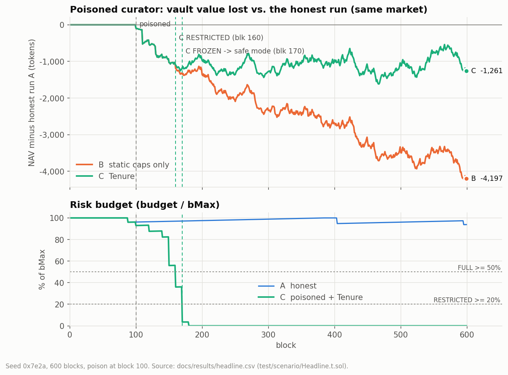
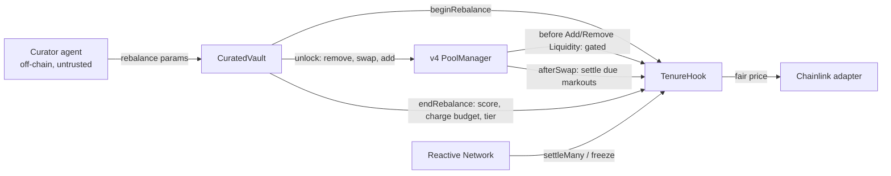

# Tenure: earned autonomy for AI liquidity curators

**We don't try to detect when an AI curator is compromised. We measure the damage its decisions cause, and its
autonomy shrinks automatically when it starts losing depositors' money.**

A Uniswap v4 hook (UHI11 hookathon, theme: Curated Liquidity). Every curator rebalance is scored at a fair
oracle price, and losses drain a risk budget. The curator drops from FULL to RESTRICTED to FROZEN as the budget
empties, and it can only earn more room (budget and deposit cap) with proven positive results.



| | Static caps only | With Tenure |
|---|---:|---:|
| Poisoned curator stopped | never (25 attack rounds) | **FROZEN on 20 / 20 seeds, 60-76 blocks after poisoning** |
| Attacker profit (median of 20 seeds) | 1,586 tokens | **650 tokens (-59%)** |
| Value kept for depositors vs static caps | - | **~2,770 tokens (3.5% of NAV) per run** |

The honest curator was never restricted (FULL in every block of every seed). Source: [`docs/RESULTS.md`](docs/RESULTS.md).

---

## The problem

- In curated liquidity, depositors hand money to a curator who manages LP positions, and the curator is fully
  trusted. Arrakis states that its manager is off-chain and trusted, bounded only by static per-block limits.
- Mandate drift is real. In the Stream Finance collapse (Nov 2025), a curator changed strategy without depositor
  consent, and risk-curator vault TVL fell from about $10B to about $6.9B within days.
- AI curators make it worse. Princeton's CrAIBench (arXiv 2503.16248) shows that memory or context injection makes
  agents take harmful actions, and that injection detectors help little once stored context is corrupted. You
  cannot reliably detect a poisoned agent by inspecting the agent.
- Static caps stop one big loss, but not a slow bleed of many small, individually valid bad decisions. The killer
  attack: poison the curator into placing liquidity at a manipulated price, then trade against it. No theft
  transaction ever happens.

## The four layers

1. **Mandate.** Bounds the depositors agreed to: range width, maximum distance from the fair price, maximum value
   swapped per action, cooldown. Changes are timelocked, so depositors can exit first.
2. **Decision measurement (the core).** Every rebalance is scored at the fair price. Immediate leakage is charged
   at once. After W blocks, a markout `alpha` compares the decision with not rebalancing at all.
3. **Risk budget to autonomy tiers.** A leaky bucket that losses drain and slow refill restores. FULL is at least
   50% of the bucket, RESTRICTED is 20-50% (half the move cap, double cooldown and min width), and FROZEN is below
   20% (safe mode; only the guardian can restore, after a timelock, and only to RESTRICTED).
4. **Pool-native reputation.** The bucket size and the vault's deposit cap grow only with positive alpha that the
   hook itself measured. There is no external, Sybil-prone score.

Withdrawals are always open: no tier check, no oracle, no price.

## Theme mapping: Curated Liquidity, active management and curation

| Theme idea | In Tenure |
|---|---|
| Curator strategy parameters | The **mandate**: width bounds, maximum distance from fair, move cap, cooldown, timelocked changes |
| AI curator driven by off-chain signals or ML | The untrusted off-chain **curator agent**. Tenure grades its decisions, not its model or prompts |
| Reputation-weighted AUM | The **deposit cap** and the risk bucket grow only with alpha the hook measured itself |
| Active management with guardrails | **Autonomy tiers**: FULL, then RESTRICTED (tighter mandate), then FROZEN (safe mode, guardian restore) |

## Why it must be a hook

- The hook gates every `modifyLiquidity` on the vault's position. The curator cannot move liquidity outside a
  measured session (`Tenure__NoSession`).
- The hook reads pool state and the vault's position directly from the PoolManager, so it measures independently
  of the curator.
- Markouts settle keeper-free in `afterSwap` (at most one per swap), and anyone can settle them.



## Sponsor integrations

- **Chainlink is the fair price.** `ChainlinkReferencePrice` turns token/USD feeds (or a direct feed) into the
  fair `sqrtPriceX96` that every score uses. Stale, incomplete or non-positive answers revert. Feeds are set once
  per pool. ([`src/ChainlinkReferencePrice.sol`](src/ChainlinkReferencePrice.sol))
- **Reactive Network makes settlement keeper-free and propagates freezes across vaults.** `TenureSettlerRC` watches
  `RebalanceScored` plus a CRON topic and calls `settleMany` through a callback receiver. `TenureFreezeRC` relays a
  FROZEN tier on one vault to the same curator's vault elsewhere. The relay can only freeze, never unfreeze or move
  funds. ([`src/reactive/`](src/reactive))
- **Unichain is the L2 home.** On 1-second blocks, Tenure's overhead is about $0.016 per rebalance instead of $16
  on mainnet. Deploy scripts target Unichain Sepolia + Lasna ([`docs/DEPLOY.md`](docs/DEPLOY.md)).

## Cost ([`docs/GAS.md`](docs/GAS.md))

| | Gas |
|---|---:|
| Swap on a Tenure pool (nothing due) | +17,205 over a hookless swap |
| Rebalance overhead (snapshot, mandate, score, record) | +537,900 (849,110 vs 311,210) |
| Withdraw (works in every tier) | 174,970 |

On mainnet the overhead (~$16 per rebalance) fits vaults above about $1M. On a 1-second L2 it is negligible.

## Threat model summary ([`docs/THREAT_MODEL.md`](docs/THREAT_MODEL.md))

- **Park-then-follow attack** (the slow bleed static caps miss): caught by the markout. FROZEN after 3 rounds.
- **Fee masking** (hiding a leak behind collected LP fees): fixed; holdings include owed fees.
- **Window gaming:** a small, unprofitable grading gap. If the attacker strikes after the markout window, loss
  realized after grading is not charged. Settlement needs spot within `maxSettleDev` of fair, so only the last
  leg escapes: 2.9% of the damage for a 400-tick attack, and all of a tiny 90-tick one. Over 20 repeated rounds the
  vault lost 0.07% of NAV while the attacker lost money on fees. A fix (lifetime grading, value at fair) is
  planned as M5.5.
- **Alpha inflation:** an accomplice can settle at the edge of the spot band to add positive alpha (reputation),
  bounded under 0.1% of NAV per record and paid for at about cost. Same planned fix.
- **Oracle:** stale or future-dated prices block sessions and settlements but never swaps or withdrawals. An honest
  curator cannot be graded down by spot manipulation at settlement.
- **Bypass and reentrancy:** direct PoolManager calls touch only the caller's own position. Every hook and vault
  entry point refuses re-entry from inside a session. 7 system invariants hold over 128,000 random calls.

## Limitations

- The fair price is a trust root. A wrong or compromised feed misprices every score; a feed far from the market
  stalls markouts rather than scoring them. There is no second-source deviation check yet.
- One vault per pool, one range per vault (MVP).
- The hook is 22,528 B with via-IR, only 48 B above its own 2,000 B headroom guard. New logic must move math into
  the linked `TenureScorer` library first.
- Window gaming and alpha inflation are bounded but open (M5.5).
- Token callbacks (ERC777-style) are not supported. They cannot break the guards, but they can grade the curator
  adversely.
- Testnet deployment is scripted and dry-run but not yet broadcast.

## How to run

```bash
forge test                                   # full suite (default profile)
FOUNDRY_PROFILE=deploy forge test            # what ships: via-IR build
python -m pytest sim -q                      # Python reference model + test-vector freshness
python sim/plot_results.py                   # regenerate charts from docs/results/*.csv
```

Local demo (anvil; replays the headline scenario one block per transaction, see [`docs/DEMO.md`](docs/DEMO.md)):

```bash
anvil                 # terminal 1
bash script/demo.sh   # terminal 2
```

Testnet (Unichain Sepolia + Reactive Lasna): [`docs/DEPLOY.md`](docs/DEPLOY.md). Always deploy with
`FOUNDRY_PROFILE=deploy`; the default profile builds a hook over the 24,576 B contract-size limit.

Further reading: [`docs/MATH.md`](docs/MATH.md) (scoring math), [`docs/RESULTS.md`](docs/RESULTS.md),
[`docs/GAS.md`](docs/GAS.md), [`docs/THREAT_MODEL.md`](docs/THREAT_MODEL.md).
