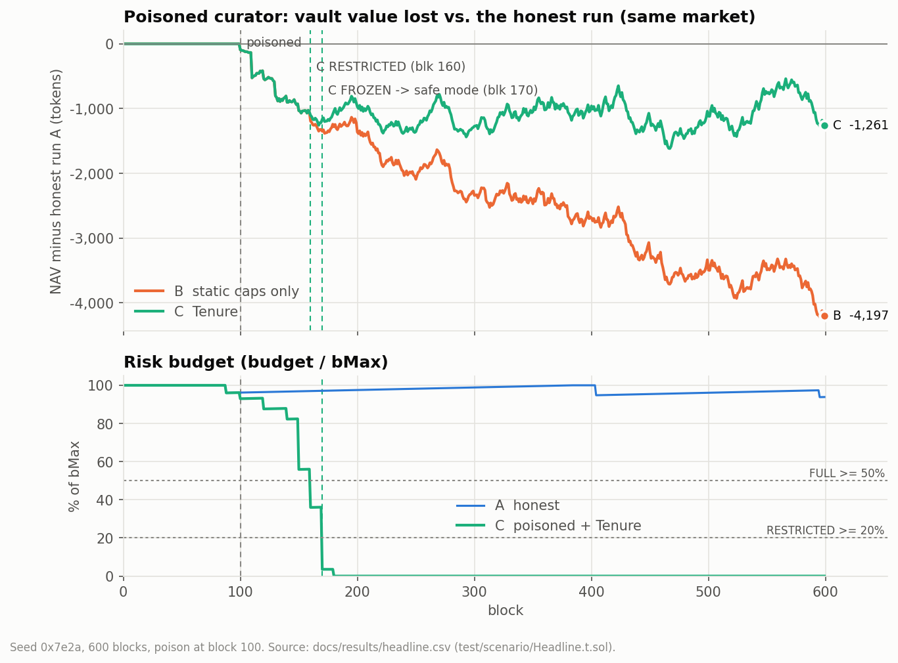
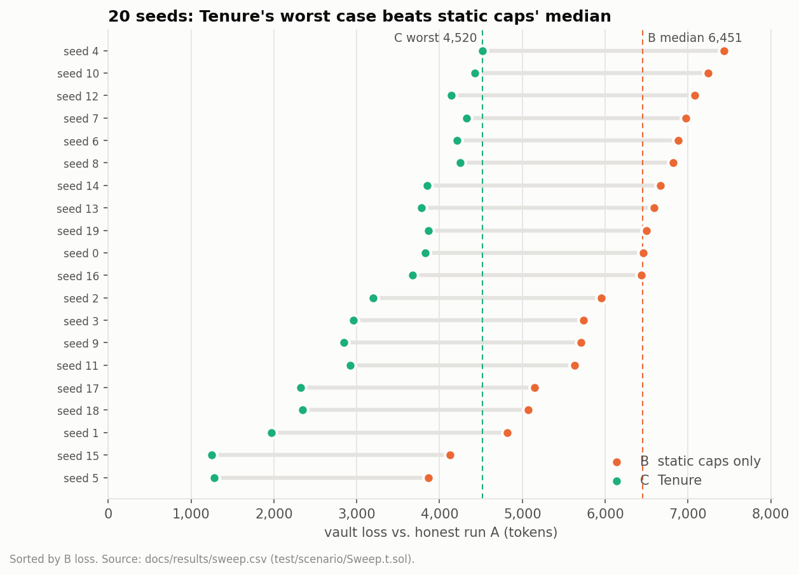
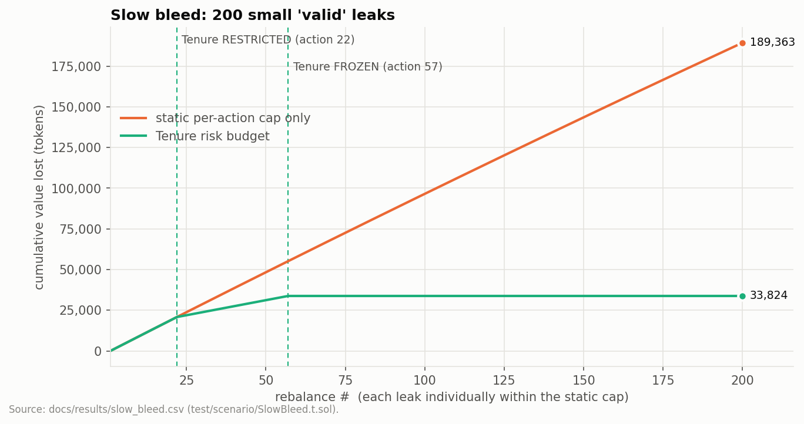

# Tenure results

All numbers come from Foundry tests against a real v4 PoolManager, the real `TenureHook` and the real
`CuratedVault`. Tokens are whole token units (18 decimals) valued at the fair price. Raw data lives in
`docs/results/`. Charts are regenerated from the CSVs by `python sim/plot_results.py`.

**Rounding (one rule for every figure computed from the CSVs here, in the README and in the frontend):** token
amounts are rounded half up to whole tokens, percentages half up to the shown digit. A median of the 20 seeds is the
mean of the two middle seeds, computed exactly before rounding.

## Setup (shared by every run)

- Vault: 40,000 + 40,000 tokens at price 1 (NAV about 80,000), curator range +-600 ticks.
- Pool: 2e23 full-range third-party liquidity, so the vault's concentrated liquidity matters near the price.
- Market: seeded random walk of the fair price (+-20 ticks per block), a noise trade of up to 2,000 tokens each
  block, then arbitrage of spot back to fair. 600 blocks.
- Tenure budget: 2% of NAV, refilled over about 7,200 blocks; FULL >= 50%, RESTRICTED >= 20%, else FROZEN.
- Poison at block 100. The poisoned curator alternates "park the range 1,500 ticks away, rebalancing inventory
  (<= 5% of NAV)" and "re-center on spot". Each attack round, the attacker pushes spot 400 ticks below fair,
  the curator follows, and the attacker arbitrages back in the same block. See `docs/THREAT_MODEL.md` section 2.
- Run A: honest curator + Tenure. Run B: poisoned curator + static caps only (the same hook with the budget set
  to 100% of NAV, so it never binds). Run C: poisoned curator + Tenure; when FROZEN, the vault owner enters safe
  mode (liquidity pulled to idle).
- B and C run byte-identical curator and attacker code; the test asserts that their hook settings differ only
  in `bMax0` / `bMaxCap` (`HeadlineBase._runBC`).

## Seed sweep: 20 seeds (M4.2b)

`test/scenario/Sweep.t.sol`; per-seed rows in `docs/results/sweep.csv`.

| Metric (20 seeds) | Median | Worst / best |
|---|---:|---:|
| B: vault loss vs A (tokens) | 6,451 | worst 7,435 |
| C: vault loss vs A (tokens) | 3,729 | worst 4,520 |
| B: attacker profit (tokens) | 1,587 | best 1,697 |
| C: attacker profit (tokens) | 650 | best 748 |
| B: attack rounds completed | 25 | 25 |
| C: attack rounds before FROZEN | 3 | max 3 |
| C: blocks from poison to RESTRICTED | 60 | max 66 (FULL -> FROZEN within one block on 5 seeds) |
| C: blocks from poison to FROZEN | 70 | max 76 (frozen on 20 / 20 seeds) |
| A: minimum budget ratio | 95.4% | worst 83.1% (FULL in every block of every seed) |

**Acceptance:** A stays FULL on every seed (asserted every block). C's worst-case loss (4,520) is below B's
median loss (6,451).

### How to read "loss vs A" (important)

"Loss vs A" is NAV(A) - NAV(run) at block 600. It mixes two things:
1. **Attack damage.** The attacker's profit is the cleanest measure of it: 650 under Tenure vs 1,587 with static
   caps (median). Tenure stops the attack after about 3 rounds instead of letting it run for 25.
2. **Market divergence.** After the attack starts, B and C hold different positions from A (parked ranges,
   inventory swaps, and for C an idle vault after safe mode). On a random walk their NAVs drift away from A's in
   both directions. This part is large: on every seed B and C share most of it, and the gap B - C is very stable
   (2,571 to 2,938 tokens, median 2,771). That gap is the value Tenure kept for depositors in this
   scenario, while the common part is mainly how this particular poisoned policy and the market path interact.

So the honest headline is: **Tenure froze the poisoned curator on 20 / 20 seeds within 60-76 blocks of the
attack starting, cut attacker profit by 59% (median), and saved a median 2,771 tokens (3.5% of NAV) per run vs static
caps, while never restricting the honest curator.** Loss vs A should not be read as pure attack damage.

### Caveats
- One attacker strategy, one pool depth, one budget setting. M5.2 probes other attacks.
- C's loss after freezing is bounded only for the attack; an idle vault still moves with the market.
- On 5 seeds, two bad markouts settled in the same block, so C went FULL -> FROZEN without a sampled
  RESTRICTED block.

## Headline seed 0x7e2a (M4.2)

`test/scenario/Headline.t.sol`; per-block NAV, budget ratio and tier in `docs/results/headline.csv`.
A: FULL in all 600 blocks. B: 25 rounds, -4,197 vs A, attacker +1,563. C: RESTRICTED at block 160, FROZEN at
170 after 3 rounds, -1,261 vs A, attacker +625.

## Slow bleed (M1.6)

`test/scenario/SlowBleed.t.sol`; `docs/results/slow_bleed.csv`. 200 small leaks, each inside the static
per-action cap: the static cap allows all of them; Tenure's budget restricts at action 22 and freezes at 57.

## Live testnet run: withdrawal while FROZEN (Unichain Sepolia, 2026-11-26)

`script/demo_testnet.sh` against the deployed demo pool A (vault `0xA1478638E58333e3910aEfCA9616468503FC744B`):

- Ticks 100-210 ran with vault A FROZEN throughout. Attack rounds stayed at 3, the attacker's profit stayed at
  +739 tokens, and NAV vs start recovered from -788 to -423 (an idle vault still moves with the market).
- Then the depositor redeemed all 79,999,999,999,999,999,000,000 shares of the FROZEN vault: tx
  [`0xfd84e1bc71bf633e8bd0453d1057ecc343301d21a04171a6e332188a2ae78ce7`](https://sepolia.uniscan.xyz/tx/0xfd84e1bc71bf633e8bd0453d1057ecc343301d21a04171a6e332188a2ae78ce7)
  (block 68,844,903, 249,186 gas). Withdrawals have no tier check, no oracle and no price dependency.
- Afterwards `totalSupply() == balanceOf(0xdEaD) == 1,000,000`. These are the dead shares
  (`CuratedVault.DEAD_SHARES = 1e6` base units, 1e-12 of a share) burned at the first deposit against
  share-inflation attacks. They can never be redeemed, by design.
- Max gas of any tx in the run: 328,027 (the per-tx limit was 3,000,000).
